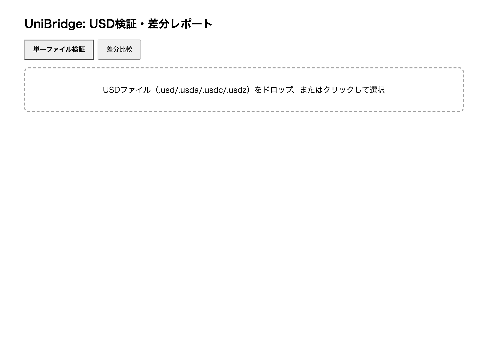
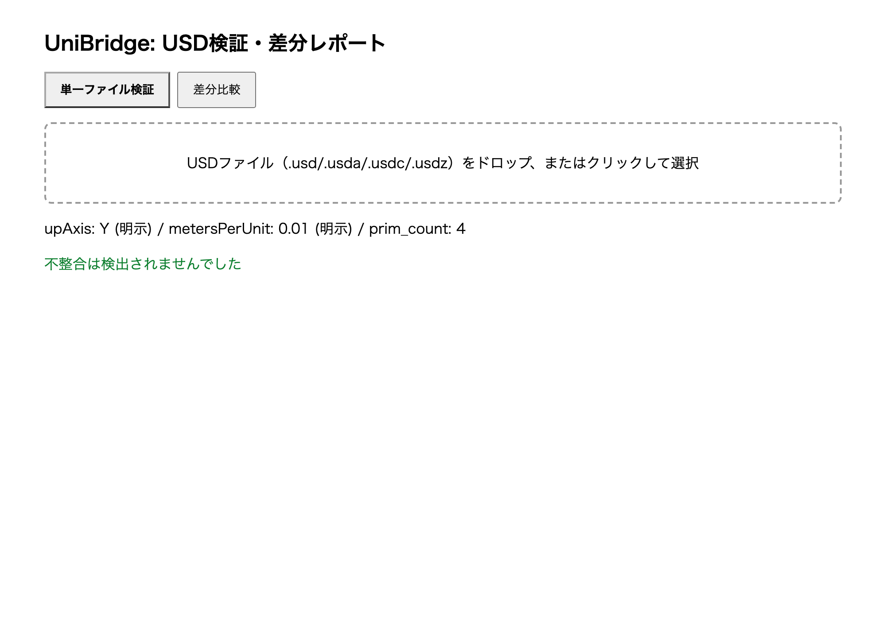
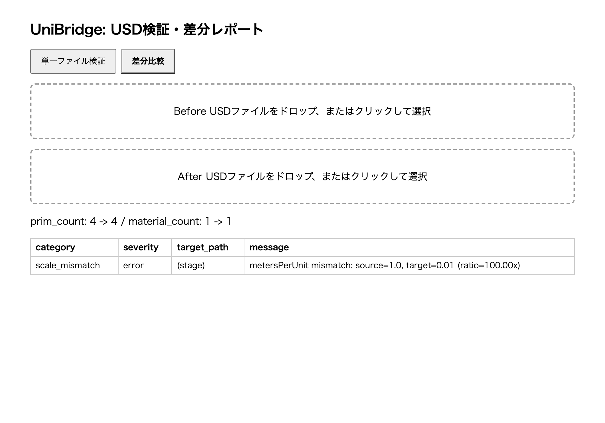

# UniBridge

> **English summary.** UniBridge checks OpenUSD scenes exchanged between Houdini (Solaris) and Blender. It detects up-axis and scale (metersPerUnit) mismatches, naming-rule violations, unresolved references, and material, UV, variant and purpose problems, and writes CSV / JSON / HTML reports. It only reports; conversion happens only when you ask for it (`scale-check --apply`). The core depends on `usd-core` alone, so it runs without Houdini or Blender; the DCC adapters are verified on real Blender 3.5.1 to 5.0.0 and Houdini 22.0.429 ([records](docs/verification/README.md)). Install with `pip install .` and run `unibridge --help`.

HoudiniとBlenderの間で受け渡すOpenUSD（USD）シーンの整合を検査するツール。座標系（upAxis）・スケール単位（metersPerUnit）・命名規則の不整合を検出し、CSV/JSON/HTML形式の差分レポートを生成する。変換は、明示的に指定したとき（`scale-check --apply`）だけ行う。

## 目的・背景

HoudiniとBlenderは共にUSDをネイティブサポートするが、DCC間を往復させると座標系（Y-up/Z-up）やスケール単位（m/cm）が静かに食い違うことがある。UniBridgeはこの不整合を検出とレポートに限定し（自動修正は行わない、[ADR-0005](docs/adr/0005-report-only-no-autofix.md)）、パイプラインTDが安全に問題箇所を特定できるようにする。

詳細な要件定義・設計判断は [docs/要件定義書.md](docs/要件定義書.md) / [docs/仕様書.md](docs/仕様書.md) / [docs/adr/](docs/adr/) を参照。

## アーキテクチャ（Ports & Adapters、2アダプタ構成）

`core/`（検証ロジック）は `usd-core`（`pxr`）にのみ依存し、`hou`/`bpy`を一切importしない。実DCC呼び出しは `adapters/houdini_adapter.py`（hython専用）・`adapters/blender_adapter.py`（`blender --background`専用）の2つに閉じ込めている（[ADR-0002](docs/adr/0002-dual-adapter-architecture.md)）。これにより **Houdini/Blenderがインストールされていない環境でもcore層全体をTDDで検証できる**（usd-coreはpipで単独インストール可能なDCC非依存パッケージのため）。

```
unibridge/
├── core/                    # DCC非依存、pxrのみに依存（フルカバレッジ対象）
│   ├── scale_check.py       # 座標系(upAxis)・スケール単位(metersPerUnit)の検出・変換
│   ├── hierarchy_check.py   # 命名規則チェック
│   ├── diff_report.py       # Prim/Material数の差分レポート(CSV/JSON/HTML)
│   ├── rules.py             # 命名規則YAML読込(yaml.safe_loadのみ、SEC-001)
│   └── report_models.py     # DiffEntry / DiffReport 等のdataclass
├── adapters/
│   ├── houdini_adapter.py   # hou.LopNode経由のUSDエクスポート(hython専用、実機未検証)
│   └── blender_adapter.py   # bpy.ops.wm.usd_import/export経由の読込検証(blender --background専用、実機検証済み)
├── cli.py                    # core層のみで完結するCLI(diff/scale-check/integrity-check/hierarchy-check/batch)
├── cli_houdini_entry.py      # hythonから起動するCLIエントリポイント
├── cli_blender_entry.py      # blender --backgroundから起動するCLIエントリポイント
├── webui/                    # FastAPI + 静的HTML/fetchの簡易Web GUI(ADR-0004)
├── core/default_rules.yaml   # 既定命名規則(パッケージに同梱)
├── sample_scenes/            # 検証用フィクスチャUSDA(mismatched_scale/upaxis/consistent)
└── tests/
```

## 技術スタック

- Python 3.11+ / usd-core 26.8（pip配布、DCC非依存）
- FastAPI + uvicorn（簡易Web GUI）/ PyYAML（`yaml.safe_load`のみ）
- pytest / pytest-cov / mypy(strict, adapters/のみhou/bpyスタブ不在のため除外) / black / isort / flake8 / pip-audit

## インストール（利用者向け）

TestPyPI への公開を設定したあとは、次の形で入れる(公開の設定は「リリース手順」を参照)。

```bash
pipx install --index-url https://test.pypi.org/simple/ --pip-args="--extra-index-url https://pypi.org/simple/" unibridge
unibridge integrity-check --usd scene.usda
```

ソースから入れる場合は、`pip install .` で `unibridge` コマンドが使える(既定の命名規則と Web UI の静的ファイルは同梱される)。

## インストール（開発・テスト用、Houdini/Blender不要）

```bash
python -m venv .venv && source .venv/bin/activate
pip install -e ".[dev]"
pytest --cov=core --cov-fail-under=80
```

usd-coreのインストールには数分かかる場合がある。

## 使用方法（CLI、core層のみで完結）

```bash
python cli.py diff --before sample_scenes/consistent_scene.usda \
                    --after sample_scenes/mismatched_scale.usda --format json
python cli.py scale-check --source sample_scenes/consistent_scene.usda \
                           --target sample_scenes/mismatched_scale.usda
python cli.py integrity-check --usd sample_scenes/consistent_scene.usda --format json
python cli.py hierarchy-check --usd sample_scenes/consistent_scene.usda
python cli.py batch --dir sample_scenes/ --format json --workers 4
```

`integrity-check` は、既定 Prim・解決できない参照・マテリアルの割り当て・UV・variant の選択・purpose を調べる([ADR-0006](docs/adr/0006-integrity-checks-without-usdchecker.md))。`--format json` は、ツール間で共通の形式([スキーマ](docs/schema/common-report.schema.json))で出力する。

終了コード: `0`=不整合なし / `1`=不整合あり / `10`〜`14`=エラー系（詳細は [docs/仕様書.md §5.7](docs/仕様書.md)）

## 使用方法（実機・hython/Blender専用）

```bash
hython cli_houdini_entry.py export --lop /stage/out --output out.usda
blender --background --python cli_blender_entry.py -- --usd out.usda --reexport --out reexported.usda
```

## 画面とレポートの例

Web UI(`webui/`)の画面。上から、開いた直後・単一ファイルの検証・差分の比較。







`python cli.py diff --before sample_scenes/consistent_scene.usda --after sample_scenes/changed_structure.usda --format all --out docs/samples` で作ったレポート(CSV)。JSON と HTML も同じ場所にある([docs/samples/](docs/samples/))。

```csv
category,severity,target_path,message,before_value,after_value
prim_removed,error,/root/mat_hero,prim /root/mat_hero exists in before but missing in after,,
prim_added,info,/root/GeoExtra,prim /root/GeoExtra newly appears in after (not present in before),,
material_count_diff,warning,(stage),material count changed: 1 -> 0,1,0
```

`integrity-check --format json` の出力は、ツール間で共通の形式。全文は [docs/samples/integrity-check.json](docs/samples/integrity-check.json)。

```json
{
  "schema_version": "1",
  "tool": "unibridge",
  "subject": "sample_scenes/changed_structure.usda",
  "has_errors": false
}
```

## 使用方法（簡易Web GUI）

```bash
uvicorn webui.main:app --host 127.0.0.1 --port 8000 --reload
# http://localhost:8000 でUSDファイルをドラッグ&ドロップして検証・差分比較
```

既定のバインドは `127.0.0.1`（自分のマシンからのみ接続可能）。`--host 0.0.0.0` などで外部に公開する場合は、認証・TLS・リバースプロキシを別途用意し、`webui/main.py` の `allow_origins` も限定すること（このWeb UIには認証機能がない）。

アップロードの安全対策（信頼できないUSDを受け付ける前提）:

- リクエスト本文は `Content-Length` で事前に判定し、チャンク読み込みで上限を超えた時点で打ち切る（413）。
- 同時アップロード数に上限を設ける（超過は503）。一時ファイルは成否にかかわらず削除する。
- USDの解析は別プロセスで実行し、制限時間を超えたら強制終了する（504）。
- 絶対パス・`..`・URLスキームを含む外部参照（sublayer / reference / payload）を持つUSDは拒否する（422）。

上限は環境変数で変更できる:

| 環境変数 | 既定値 | 意味 |
| --- | --- | --- |
| `UNIBRIDGE_MAX_UPLOAD_BYTES` | `209715200`（200MB） | 1ファイルあたりの上限 |
| `UNIBRIDGE_MAX_CONCURRENT_UPLOADS` | `4` | 同時に処理するアップロード数 |
| `UNIBRIDGE_PARSE_TIMEOUT_SECONDS` | `30` | 1リクエストの解析の制限時間（秒） |

## テスト

```bash
pytest --cov-fail-under=90
black --check . && isort --check . && flake8 . && mypy core/ commands/ cli.py webui/
python tests/benchmark.py   # 性能測定(手動実行、CI組み込みなし。結果は docs/benchmarks.md)
```

現状: **pytest 213件全てpass、カバレッジ98%**(`core/` `commands/` `adapters/` が対象。`adapters/` は偽の `hou` / `bpy` による契約テスト)。black/isort/flake8/mypy strict全てパス。Hypothesis による性質テストを含む。

### ドキュメントと実装の乖離（実装時に判明、修正済み）

仕様書§5.2は「metersPerUnit未設定時のUSD既定値は1.0」と記載しているが、usd-core 24.11で実測した結果、**実際の既定値は0.01（centimeters）**であることを確認した。`core/scale_check.py`のdocstring・テストは実測値に合わせて修正済み（コード自体は`UsdGeom.GetStageMetersPerUnit()`の戻り値をそのまま使うため、この乖離はドキュメント側のみの問題で実装に影響はない）。usd-core 26.8への更新後も同様に実測し、既定値が0.01のまま変わっていないことを再確認した。

### 既知の脆弱性（pip-audit、解消済み）

以前は仕様書§3.1で指定されたバージョン制約（`usd-core<25`, `pytest<9`）により、`pip-audit`で以下2件の既知脆弱性が検出されていた。

| パッケージ | 旧バージョン | 脆弱性ID | 修正版 |
|---|---|---|---|
| usd-core | 24.11 | GHSA-grjp-54v3-c442 | 25.11 |
| pytest | 8.4.2 | PYSEC-2026-1845 | 9.0.3 |

`pyproject.toml`のバージョン上限を撤廃し（`usd-core>=25.11`, `pytest>=9.0.3`）、実際に`usd-core 26.8`・`pytest 9.1.1`へ更新することで解消した（先行プロジェクトpipeinitでの対応実績に倣う）。更新後も`pytest --cov=core --cov-report=term-missing --cov-fail-under=80`（53件pass、カバレッジ94.66%）、`black --check . && isort --check . && flake8 . && mypy core/ cli.py webui/ --exclude adapters/`は全てパスし、`usd-core 26.8`での`metersPerUnit`未設定時の既定値も0.01のまま変化していないことを実測で再確認した。`pip-audit`実行結果は`No known vulnerabilities found`。

## 実機検証結果

版ごとの記録は [docs/verification/](docs/verification/README.md) に残している(Blender 3.5.1 / 3.6.0 / 4.0.0 / 4.5.3 / 5.0.0 は 2026-10-27 に全項目 PASS、Houdini 22.0.429)。性能は [docs/benchmarks.md](docs/benchmarks.md)。以下は最初の検証(2026-09)の経緯。

### Blender実機検証（Blender 4.0.0、`blender --background`、実機検証済み）

Houdini MCPが本開発環境では接続不可（`ConnectionRefused`）だったため、この時点ではHoudini側アダプタ（`adapters/houdini_adapter.py`）は実機未検証のまま残っていた（後日、Houdini本体がSteam経由でローカルにインストール済みであることが判明し、hython直接実行による実機検証を別途実施済み。詳細は後述のHoudini実機検証セクションを参照）。一方Blenderはローカルに複数バージョンがインストールされていたため（`/Applications/Blender.app`、4.0.0）、`adapters/blender_adapter.py` と `cli_blender_entry.py` を実機で検証した。

検証コマンド:

```bash
blender --background --python cli_blender_entry.py -- \
  --usd sample_scenes/consistent_scene.usda --reexport --out /tmp/blender_reexport.usda
```

実機検証で2件の問題を発見・修正した。

| 発見箇所 | 症状 | 原因 | 対応 |
|---|---|---|---|
| `cli_blender_entry.py`の`adapters`インポート | `ModuleNotFoundError: No module named 'adapters'` | Blenderの`--python`実行では、スクリプト自身のディレクトリが自動的に`sys.path`へ追加されるとは限らない | `Path(__file__).resolve().parent`を明示的に`sys.path`へ追加 |
| `import_usd()` | インポート後のオブジェクト数が期待値(4 Prim)ではなく6件になる | Blenderの`--background`起動時点で既定のstartup.blend（Cube/Camera/Light）がロード済みの状態からusd_importするため、既定オブジェクトが混入する | `import_usd()`内で`bpy.data.objects`を全削除してからインポートするよう修正（`_clear_default_scene()`追加） |

修正後、`sample_scenes/consistent_scene.usda`（4 Prim: root/xform_hero/geo_body/mat_hero）に対し**正しく3オブジェクト**（Blenderはグルーピング用のScope相当を1オブジェクトとして扱わないため4ではなく3）をインポートすることを確認した。

**さらに重要な実データ由来の発見**: `--reexport`で往復（round-trip）検証を行ったところ、入力USD（`upAxis=Y`、Houdini/Solaris側の一般的な設定を想定）をBlenderで読み込み、そのまま再エクスポートすると、**出力USDの`upAxis`が`Z`に変わる**ことを確認した（Blenderの内部座標系がZ-upであり、USD I/Oのエクスポート時に常にStageのupAxisをBlenderの座標系(Z-up)に合わせて書き出すため）。

```
入力: upAxis=Y (sample_scenes/consistent_scene.usda)
  ↓ Blender USD import → USD export (bpy.ops.wm.usd_import / usd_export)
出力: upAxis=Z (blender_reexport.usda)
```

この`before`/`after`ペアに対し実際に`python cli.py scale-check`を実行した結果:

```
$ python cli.py scale-check --source sample_scenes/consistent_scene.usda --target /tmp/blender_reexport.usda
[error] up_axis_mismatch: (stage): upAxis mismatch: source=Y, target=Z
```

**UniBridgeが検出しようとしている「DCC往復での座標系不整合」を、実際のBlender I/Oの挙動から実データで再現・検出できることを確認した。** これはADR-0003（BlenderのUSD I/Oの実際の変換挙動を検証対象に含める設計判断）の妥当性を裏付ける実証結果である。

### Houdini実機検証（2026-09-08実施）

Houdini MCP（`houdini`）は本セッションでも引き続き`ConnectionRefused`で接続できなかったが、Houdini本体はSteam経由でローカルにインストール済み（Houdini Indie 22.0.429）であることが判明したため、MCPを使わずhython（`.../Houdini Indie/Frameworks/Houdini.framework/Versions/22.0/Resources/bin/hython`）を直接Bashで起動して実機検証を行った（Scene Doctorの`hou_adapter.py`実機検証と同一手法）。

既存のテストシーン`tornado_00.hiplc`/`spiderweb_v1.hiplc`は読み取り専用で開き、`/stage`にLOPsネットワークが存在しない（通常のSOPシーン）ことをまず確認した。そのため、これらのファイルは一切上書きせず、hython上でメモリ上に新規のLOPsネットワーク（`sphere`/`cube` LOPノード + `merge`ノードで構成する`/stage`）を組み立て、それを対象に`adapters/houdini_adapter.py`の`export_stage_from_lop` / `list_lop_children`を実際に実行して検証した。

検証内容:

- `list_lop_children("/stage")` が構築した3ノードのパスを正しく返すこと
- `export_stage_from_lop()` でusda/usdc双方の形式にエクスポートできること
- エクスポートしたUSDファイルに実際のプリム（`sphere1`/`grid1`）が含まれること
- 存在しないノードパス・LOPノードでないノード（`/obj`）を指定した場合に`LopNodeNotFoundError`が正しく送出されること
- エクスポートしたUSDファイルに対し`python cli.py scale-check`（venv側）を実際に実行し、UniBridge本体のCLIから問題なく読み込めること

実機検証で1件の重大なバグを発見・修正した。

| 発見箇所 | 症状 | 原因 | 対応 |
|---|---|---|---|
| `export_stage_from_lop()`の`stage.GetRootLayer().Export()` | エクスポートしたUSDファイルにジオメトリ等のプリムが一切含まれず、`subLayers`に匿名レイヤーへの参照のみが書き出される（Houdiniセッション終了後は解決不能なファイルになる） | Houdini LOPノードの`stage()`が返す合成済みStageは、各ノードの出力を保持する複数の匿名sublayer（`anon:0x...:LOP`）から構成されている。`stage.GetRootLayer()`はそのうちルートレイヤー（sublayer参照のみを持つ空に近いレイヤー）しか指さないため、それだけを`Export()`すると実際のプリム定義（他のsublayerにある）が失われる | `stage.GetRootLayer().Export()`を`stage.Export()`（`Usd.Stage.Export`、合成結果をフラット化してから書き出す）に修正。修正後、実際にsphere/cubeプリムを含む正しいUSDファイルが出力されることを確認した |

修正後、`export_stage_from_lop`/`list_lop_children`のエラーケース・正常系ともに全て期待通りに動作することを確認した。コードはScene DoctorのPorts & Adaptersパターン（`hou_adapter.py`）に倣って実装済みであり、`adapters/houdini_adapter.py`・`cli_houdini_entry.py`のdocstringは実機検証済みである旨に更新した。

## リリース手順

1. `pyproject.toml` の `version` を上げ、`CHANGELOG.md` に同じ版の節を足す(テストが両者の一致を確かめる)
2. `main` にマージしたあと、`git tag v<版>` を打って push する
3. `Release` ワークフローが、版の一致を確かめ、ビルドして TestPyPI に公開し、GitHub Releases を作る

TestPyPI への公開には、PyPI 側の Trusted Publishing の設定(リポジトリ `nokgc333/unibridge`、ワークフロー `release.yml`、環境 `testpypi`)が要る。アカウントの設定なので、利用者本人が行う。

## 設計判断(ADR)

| 番号 | 内容 |
| --- | --- |
| [0001](docs/adr/0001-adopt-usd-over-fbx.md) | FBX ではなく USD を採用する |
| [0002](docs/adr/0002-dual-adapter-architecture.md) | `core` と 2 つの DCC アダプタに分ける |
| [0003](docs/adr/0003-bpy-for-scene-hierarchy-validation.md) | Blender の USD 入出力の実挙動も検証の対象にする |
| [0004](docs/adr/0004-cli-and-web-gui.md) | CLI と簡易 Web UI の 2 つの入口 |
| [0005](docs/adr/0005-report-only-no-autofix.md) | 検出とレポートに限り、自動修正しない |
| [0006](docs/adr/0006-integrity-checks-without-usdchecker.md) | 標準検査は usdchecker を使わず `usd-core` だけで実装する |
| [0007](docs/adr/0007-web-ui-security-policy.md) | Web UI は信頼できない USD を受け付ける前提で守る |
| [0008](docs/adr/0008-external-reference-policy.md) | 外部参照は入力の信頼度で扱いを分ける |
| [0009](docs/adr/0009-exit-code-design.md) | 終了コードは「不整合」と「実行できなかった」を分ける |

変更の履歴は [CHANGELOG.md](CHANGELOG.md)。

## セキュリティに関する注意

UniBridgeは検証対象の`.usd`/`.hip`/`.blend`ファイルを「出所が既知の信頼済み入力」として扱う。HoudiniやBlenderがPythonスクリプトを含む`.hip`/`.blend`ファイルを開いた時点でコードを実行しうるため、出所不明のファイルは開かないこと。UniBridge自身は以下を一切行わない。

- `yaml.safe_load`以外でのYAML読込（`core/rules.py`）
- `exec`/`eval`による動的コード実行（CIで`grep`による静的チェックを実施）
- 明示的な変換指定（`--apply`）以外でのファイルの書き換え（ADR-0005）

## ライセンス

MIT License（[LICENSE](LICENSE)参照）
